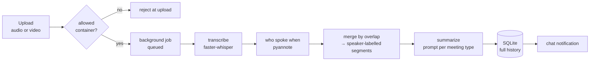
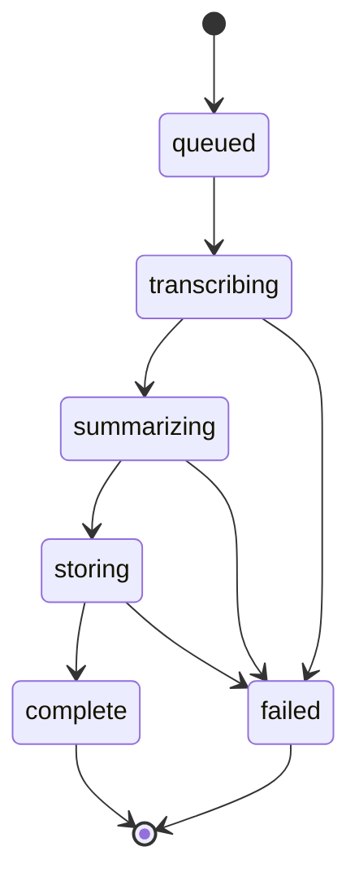

## TL;DR

Incident bridges produce two things: a fix, and a pile of commitments nobody
writes down. The fix gets done. The commitments — *who's pulling the logs, who's
telling the customer, by when* — live in the memory of whoever was on the call,
and get reconstructed days later from chat scrollback.

So I built **Meeting Recap**: upload the recording, get back a transcript where
every line has a speaker and a timestamp, and a structured summary shaped for
the kind of meeting it was. Everything runs on local models — `faster-whisper`
for the words, `pyannote.audio` for who said them, and a local LLM for the
summary. No recording leaves our own hardware.

<div class="tldr-cards">
<div class="tldr-card"><span class="tldr-num">3</span><span class="tldr-sub">meeting types, each with its own JSON contract</span></div>
<div class="tldr-card"><span class="tldr-num">1 brace</span><span class="tldr-sub">prefilled <code>{</code> skips a minute of model "thinking"</span></div>
<div class="tldr-card"><span class="tldr-num">0</span><span class="tldr-sub">bytes of audio sent to a public API</span></div>
</div>

The models were the easy part — they're off the shelf. What made it usable was
a handful of small decisions around them, and that's what this post is about.

## Why this exists

Recording a bridge is easy; every conferencing tool does it with one click.
Turning an hour of audio into something anyone will read is the part that never
happens. The person who'd write the best summary — the incident lead — is the
one who spent the call directing traffic. Whoever had a spare hand took notes,
and those notes caught whatever they happened to hear.

What people actually need from a bridge afterwards is narrow:

- **What happened, in order** — the timeline the post-incident review needs.
- **What was decided, and by whom.**
- **What everyone owes, and by when** — the part that silently falls on the floor.
- **What's still open.**

That's not a free-text summary. That's a schema. Which shaped everything below.

## The pipeline



**Upload.** It accepts the usual audio formats and the usual video containers,
because people hand you the recording exactly as the conferencing tool spat it
out — usually an `.mp4`. Anything else is rejected at upload, before it can take
a slot in the job queue. Filenames are sanitized and prefixed with a UUID on
disk.

**Normalize.** Before any model sees it, `ffmpeg` converts the file to 16 kHz
mono PCM WAV. That one step handles video (it just pulls the audio track) and
gives diarization a consistent input regardless of whether the source was a
compressed `.m4a` or a 48 kHz stereo screen recording.

**Transcribe, then diarize.** Whisper gives you *what* was said, in segments
with start and end times. Pyannote gives you *who was talking when*, as a
separate list of speaker turns. They don't know about each other.

**Summarize, store, notify.** The labelled transcript goes to the local LLM with
a prompt chosen for the meeting type; the result lands in SQLite next to the
transcript, and a formatted summary is posted to the team's chat space.

The heavy models live on a dedicated inference host behind a tiny HTTP service
(`POST /transcribe`, `GET /health`). The web app is a thin client — none of the
speech models load in the request path.

## Merging two models that don't know about each other

This is the part that sounds hard and turns out to be twenty lines. For each
Whisper segment, find the speaker turn it overlaps with the most, and give the
segment that speaker:

```python
def merge(whisper_segments, speaker_turns):
    merged = []
    for seg in whisper_segments:
        best_speaker, best_overlap = "SPEAKER_00", 0.0
        for t_start, t_end, speaker in speaker_turns:
            overlap = max(0.0, min(seg.end, t_end) - max(seg.start, t_start))
            if overlap > best_overlap:
                best_overlap, best_speaker = overlap, speaker
        merged.append({"speaker": best_speaker, "start": seg.start,
                       "end": seg.end, "text": seg.text.strip()})
    return merged
```

It's the standard approach, and on normal meeting audio it's right the vast
majority of the time. Where it goes wrong is predictable: two people talking
over each other inside one Whisper segment. The segment goes to whoever talked
longer. For a bridge call that's an acceptable error — the content survives,
only the attribution of a single crosstalk line wobbles, and the speaker-rename
step (below) makes it easy to spot.

It's O(segments × turns), which sounds bad and isn't: an hour-long call is a
few hundred of each.

## Models that come and go

This tool runs maybe once a week. `large-v3-turbo` plus the pyannote pipeline
sitting in RAM for the other six days is a poor use of a shared inference host.

So the service **lazy-loads** both models on the first request and an idle
thread **evicts** them after ten minutes with no traffic:

```python
def _idle_evictor_loop():
    while True:
        time.sleep(60)
        if models_loaded() and active_requests == 0:
            if seconds_since(last_used) >= IDLE_EVICTION_SECONDS:
                evict_models()   # drop references, gc.collect()
```

Two details matter. The evictor **never evicts mid-request** — an
active-request counter guards it — and `last_used` is bumped at every stage
(load, normalize, transcribe, diarize), so a long transcription can't look idle
halfway through. The cost is about thirty seconds of cold load on the first
recording after a quiet spell. For a job measured in minutes, nobody notices.

## One prompt per meeting type

A summary that serves an incident bridge does not serve a requirements call. So
the upload form asks what kind of meeting it was, and each type gets its own
system prompt and its own **JSON contract**:

| Meeting type | The fields it must return |
|---|---|
| **Incident bridge** | `summary`, `timeline[]` (time, speaker, event), `decisions[]` (decision, decided_by, rationale), `action_items[]` (action, owner, due), `open_questions[]` |
| **Team meeting** | `summary`, `topics[]` (topic, key_points), `decisions[]`, `action_items[]` |
| **Customer requirements** | `summary`, `requirements[]` (with must/should/nice-to-have priority), `pain_points[]`, `success_criteria[]`, `stakeholders[]`, `action_items[]`, `open_questions[]` |

The transcript goes in as `[HH:MM:SS] SPEAKER_01: text` lines, and the prompts
insist on three things: use the speaker labels **verbatim** for owners and
decision-makers, return an **empty list** rather than omit a field, and **don't
invent** anything not in the transcript.

Asking for an exact schema instead of "summarize this meeting" does two things.
It makes the output renderable — the UI and the chat notification are just
formatters over known keys. And it forces the model to commit: an action item
needs an `owner`, and if nobody took it, `due: "unspecified"` with an unclear
owner is itself the finding. That's exactly the commitment that would otherwise
evaporate.

## One prefilled brace

The local model I use for summaries is a reasoning model. Left to itself, it
spends a minute or more "thinking" in prose before it gets anywhere near the
JSON. For structured extraction that's pure latency.

The fix is one character. The request ends with an **assistant turn that
already contains `{`**, so the model continues *inside* a JSON object instead of
starting a monologue:

```python
resp = client.chat.completions.create(
    model=model_id,
    messages=[
        {"role": "system", "content": system_prompt},
        {"role": "user", "content": user_prompt},
        {"role": "assistant", "content": "{"},   # start the answer for it
    ],
    temperature=0,
)
raw = "{" + resp.choices[0].message.content
```

Then a belt-and-braces cleanup: strip any stray `<think>` block that leaks
through, and cut the text at the end of the **first balanced JSON object** (a
small brace counter that respects strings and escapes), because models like to
add a friendly sentence after the closing brace. Only then `json.loads`.

If parsing still fails, the job fails loudly — it never stores a half-summary.

## Jobs you can watch, and a restart you can afford

A long recording takes a few minutes, so uploads return a job ID immediately and
the pipeline runs in a background thread. The UI polls for status and shows the
stage instead of a spinner:



Job state is **in memory, on purpose.** It does not survive a web-server
restart. I thought about persisting it and decided not to: at roughly one
recording a week, the chance of a restart landing mid-job is tiny, and when it
does, "failed — please re-upload" costs the user one click. A durable job queue
would cost a schema, a recovery path, and stale-job cleanup, forever. Not every
reliability feature pays for itself; this one didn't.

## After the transcript

**Rename speakers.** Diarization gives you `SPEAKER_00`, `SPEAKER_01`. You know
who they are; the model doesn't. A rename mapping is stored **alongside** the
transcript rather than rewriting it, so the original labels stay recoverable if
you mislabel someone, and the names flow through both the transcript and the
summary view.

**Translate.** The summary can be produced in, or translated after the fact
into, about a dozen languages. The translation prompt is strict about what
*not* to touch: JSON keys, `SPEAKER_NN` labels, timestamps, and the
`must-have` / `should-have` / `nice-to-have` tokens stay exactly as they are, so
a translated recap still renders. If the output hits the token limit, the
request fails instead of saving a truncated summary; malformed-but-close JSON
gets one repair attempt.

**Retention.** The audio is the sensitive part and the least useful part once
you have the transcript. A daily job deletes recordings after 30 days and stamps
the recap with when its audio went; transcripts and summaries are kept.

**Narrated video.** For the people who will never read the write-up, the summary
can be rendered as a short narrated slide video, built in a separate process so
the video dependencies stay out of the web app.

## The companion: when you already have notes

A related page tackles the other half of the problem. Sometimes there's no
recording — there's a human's notes and an AI assistant's auto-generated notes,
and neither is quite right.

Paste both and it produces three things: a comparison (what you captured that
the AI missed, what the AI caught that you dropped, and where the two
**contradict** each other — "you wrote *Q2*, the transcript says *April 5*"), a
single consolidated set of minutes, and scores for coverage, accuracy, and
executive readiness. The contradictions section turns out to be the most useful
part: those are exactly the details that cause trouble a week later.

## What I'd keep from this

- **Ask for a schema, not a summary.** The value of a meeting write-up is in
  its structure — owners, dates, decisions. Make the model fill fields, and an
  empty field becomes information instead of a gap you never noticed.
- **Separate "who" from "what" and merge late.** Two narrow models plus a
  twenty-line overlap merge beat waiting for one model to do both.
- **Prefill the answer.** For structured output from a reasoning model, an
  assistant turn that starts with `{` is the cheapest latency win available.
- **Let rarely-used models leave.** Lazy-load, guard against mid-request
  eviction, evict on idle. A thirty-second cold start is fine for a weekly job.
- **Match the reliability machinery to the volume.** In-memory jobs and a
  "please re-upload" on restart was the right call at one recording a week. It
  wouldn't be at a hundred.
- **Delete the audio.** Keep the transcript, drop the recording on a schedule.

*If your team runs bridges and nobody writes them up, the recording is already
sitting there. The write-up is the cheap part now.*
