## TL;DR

Doing your own US taxes means a folder of PDFs and a nagging question: can an AI
help without being handed every figure, name and account number in them?
[**taxtrace**](https://vinayvobbili.github.io/taxtrace/) answers with the code,
not a promise. Documents are read on your own machine, by plain code and text
recognition, not a model. What a cloud model or an MCP client gets to look at
passes through one masking function first. And every value on the output sheet
carries the file, the page and the exact text it was&nbsp;read&nbsp;from.

<div class="tldr-cards">
<div class="tldr-card"><span class="tldr-num">653</span><span class="tldr-sub">tests collected in 0.2.1, all on made-up documents; CI runs Python 3.10 and 3.13</span></div>
<div class="tldr-card"><span class="tldr-num">2</span><span class="tldr-sub">cloud chat backends (Claude, Antigravity), both limited to masked text</span></div>
<div class="tldr-card"><span class="tldr-num">5</span><span class="tldr-sub">read-only MCP tools, none of which returns an amount or a name</span></div>
</div>

It never files anything. It writes an entry sheet to type into consumer tax
software, and a list of questions for whatever the documents could not
settle. MIT&nbsp;licensed.


_The mask in one pass: what stays on your machine, and the masked text a cloud model is allowed to see._

Version 0.2.1 adds two screens to `taxtrace ui`, the local page. **Import** takes
dropped files and shows the form, year and owner it recognises from the file name
and folder, never from the file's contents, then files them as `taxtrace import`
does. **Entry sheet** shows the year's rows as tables, each with value, status and
source. The release also brings a [home page](https://vinayvobbili.github.io/taxtrace/)
with demo videos on invented documents, and a shorter README with the detail in
`docs/`, one page per&nbsp;topic.

## Reading is not an AI job

Nothing needs a model to read a W-2. Each box is found by the words of its label,
with its value beside or under it, and a scanned page goes through `ocrmypdf` on
the same machine. The only model that ever sees real values is a local one, and
taxtrace refuses a server on another machine, since that server would see values&nbsp;unmasked.

## What masking does

`taxtrace redact` writes each document's layout with the values taken out. Every
digit becomes `#`, so a column keeps its shape. Every word outside a vocabulary
becomes `*` of the same length. These lines come straight from the test&nbsp;suite:

```python
redact("Total depreciation  $9,892.00").text
# 'Total depreciation  $#,###.##'
redact("Jordan Quillfeather, 4417 Brambleworth Ct, Zentonville").text
# '****** ************, #### ************ Ct, ***********'
redact("Form 4562 Line 22 Part II").text      # form and line numbers stay
redact("Tax year 2025").text                  # a year stays only where it can't be an amount
```

The vocabulary is the interesting design choice. It holds a little over 8,000
words, built from the IRS's own publications, and it is an allowlist. Nobody lists
the names, streets and towns to hide, because anything not on the list is hidden
by default. A test asserts that `denver`, `tucson`, `smith` and `john` are not in
it. The command prints only masked file names and counts, and refuses to write
its output inside a git&nbsp;repository.

## What a cloud model is sent

The chat on the local page tries three backends, by default in this order:
`claude`, then `agy` (Google's Antigravity CLI), then `local`, and the first
one that can answer wins. Claude
and agy get masked text only: the instructions, the workspace's document list and
every message pass through the same masking first. Under each answer the page
shows exactly what was&nbsp;sent.

Two further rules sit on top. A question holding an amount, or a name from
`redact-terms.txt`, isn't sent to a cloud model at all: the model on the Mac
answers it unmasked and the page says why, with an offer to ask again in masked
form (`Is $##,### of interest taxable?`). And a local answer is masked again
before any later question reaches the cloud, which a test checks. The chat has no
tools: it reads the document list and what is typed, and can't open a file or
change&nbsp;one.

The MCP server, for Claude Code or Claude Desktop, works the same way. Its five
tools (status, document list, a document's outline, form checks, the to-do list)
are read-only and return masked text. A locked PDF is reported, never opened, and
the Keychain is never asked, so a client can't trigger a password&nbsp;prompt.

## Every number, traced to its page

Each value keeps the file, the page and the exact line it came from, and the entry
sheet shows them next to a status: ready, estimate or missing. A check then looks
the quote up again on its page. In the reader for filed returns it is one
comparison per value, `row.quote not in pages[row.page - 1].splitlines()`, and
a line that isn't there is reported as a problem, not smoothed over. Anything a
reader can't settle, such as a receipt that could be a repair or an improvement,
becomes a question with the evidence next to&nbsp;it.

## Limits, plainly

- **Masking keeps the shape.** Digits become `#` one for one, so `$##,###.##`
  still says an amount has five digits before the cents. Layout is the point, and
  length comes with&nbsp;it.
- **The allowlist has a seam.** A name that is also an ordinary word (Will, Bill,
  Grace) can slip through, which is why `redact-terms.txt` exists and is
  masked&nbsp;first.
- **It isn't tax advice or a filing tool.** A preparer should review the result.
- **Narrow coverage.** Federal tables are built in for 2025 and 2026, single and
  joint. The alternative minimum tax and Form 8995-A aren't worked out, and the
  output says so. The only state return is North Carolina's D-400, for full-year
  full-year&nbsp;residents.
- **Readers fit the layouts seen so far.** An unfamiliar one becomes a
  question rather than a&nbsp;guess.
- **Best supported on a Mac.** Keychain passwords and local MLX models are
  macOS&nbsp;only.
- **No accuracy rate.** The test count is not a measured rate against real
  returns.

## What I'd take from it

Here the privacy promise is an allowlist instead of a blocklist, one masking
function shared by the command, the chat and the MCP server, and a test that
fails if an invented amount or name shows up in an MCP tool's output. "An
assistant only sees masked text" is a property of how those paths are built, not a
setting&nbsp;somewhere.

If an AI is going near documents like these, I'd steal the pattern: **let it see
the shape, keep the values at home, and make every number answer for its&nbsp;page.**

- **Home page:** [vinayvobbili.github.io/taxtrace](https://vinayvobbili.github.io/taxtrace/)
- **Source:** [github.com/vinayvobbili/taxtrace](https://github.com/vinayvobbili/taxtrace)
- **PyPI:** [pypi.org/project/taxtrace](https://pypi.org/project/taxtrace/)
